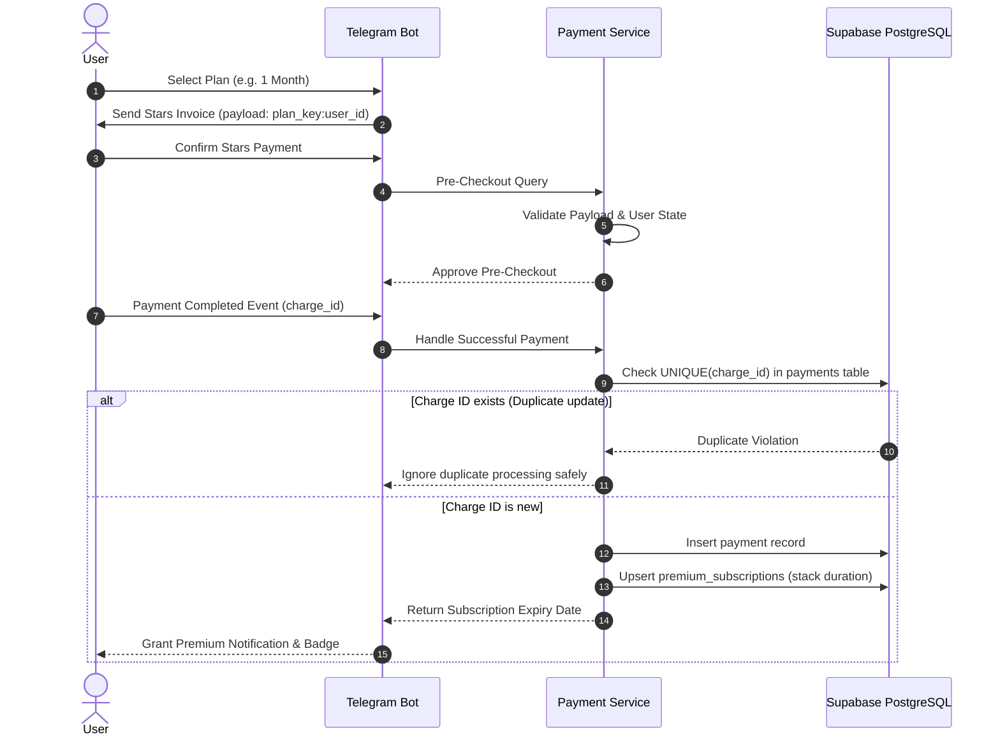

# Telegram Stars Payment Subsystem & Idempotency Specification

## 1. Overview
Date Stranger utilizes **Telegram Stars** (`XTR`) for digital product purchases. Financial transactions must be treated with strict idempotency and zero tolerance for double-granting or dropped records.

---

## 2. Plan Pricing & Configurations

| Plan Key | Telegram Stars | Duration | Display Label |
| :--- | :--- | :--- | :--- |
| `week` | 100 Stars | 7 Days | 1 Week Premium |
| `month` | 300 Stars | 30 Days | 1 Month Premium |
| `year` | 1,000 Stars | 365 Days | 1 Year Premium |

---

## 3. Payment Flow & Idempotency Safeguards

---

## 4. Subscription Stacking Rules
If a user purchases a new subscription while holding an unexpired active subscription, the new duration is **added to the existing expiration timestamp** (`expires_at = MAX(NOW(), current_expires_at) + plan_days`).

---

## 5. Mandatory Test Scenarios
1. **Successful First Purchase**: Validate premium badge, queue priority update, and correct expiration date math.
2. **Duplicate Payment Update Replay**: Replaying the same `successful_payment` event with identical `charge_id` must NOT increase duration a second time.
3. **Subscription Stacking**: Purchasing `week` followed immediately by `month` yields `NOW() + 37 days`.
4. **Invalid Payload Guard**: Tampered payload strings must trigger pre-checkout rejection (`ok=False`).
