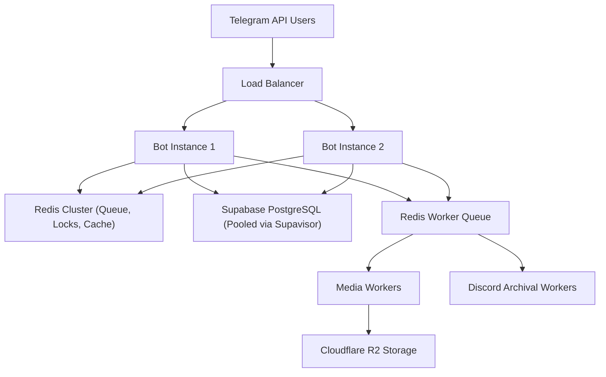

# High Scale Architecture (50,000+ Users / 1,000+ Concurrent)

## 1. Capacity Targets & Bottleneck Analysis

```text
Registered Users Target: 50,000+
Concurrent Active Users: 1,000+
Peak Message Relay Throughput: ~250 msg/sec
Peak Matching Request Throughput: ~50 matches/sec
```

---

## 2. Component Scaling Architecture



---

## 3. Bottleneck Mitigations
1. **Database Connection Limits**: Supabase database connection pooler (`Supavisor`) manages thousands of lightweight API connections.
2. **Matching Queue Bottleneck**: Redis candidate queue handles sub-millisecond filtering before atomic PostgreSQL match creation (`SKIP LOCKED`).
3. **Media Egress & Storage**: Direct Cloudflare R2 uploads bypass bot server CPU and memory. Egress bandwidth is free.
